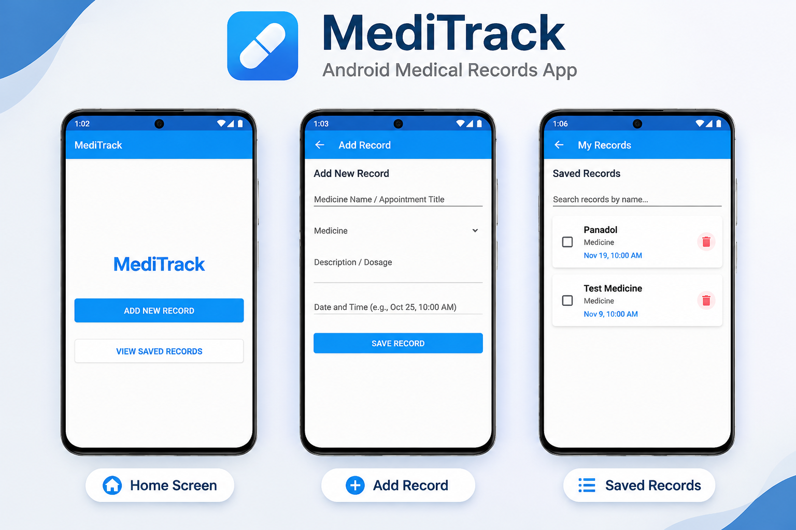
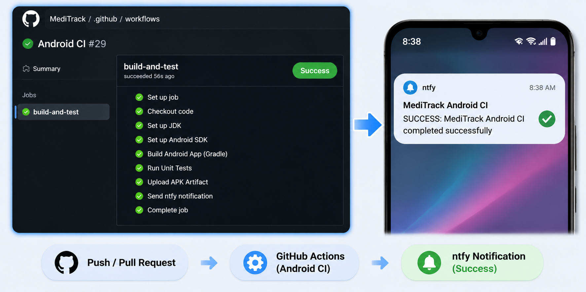

# MediTrack – Android DevSecOps

**An Android medical records application integrated with automated DevSecOps practices.**

MediTrack helps users manage personal medical records, including medications and appointments. The project integrates GitHub Actions for automated builds and testing, alongside security analysis and repository protection.

---

## 📱 Application Overview

MediTrack provides a simple interface for managing personal medical records.



**Core Features**
- Add medication and appointment records.
- Store descriptions, dosage details, and dates.
- View and search saved records.
- Delete existing records.

---

## ⚙️ DevSecOps Pipeline

GitHub Actions automates the application's build and testing workflow.

**CI Workflow**
- Automated triggers on pushes and pull requests to `main`.
- JDK 17 and Gradle environment setup.
- Automated unit testing.
- Android APK build.
- APK artifact upload.
- Build-status notifications through ntfy.



---

## 🔐 Security & Code Quality

| Tool / Control | Purpose |
|---|---|
| GitHub CodeQL | Automated static code analysis |
| Dependabot | Dependency updates and vulnerability monitoring |
| Branch Protection | Protecting the `main` branch |
| Required Status Checks | Enforcing successful CI checks before merging |


---

## 🛠️ Technology Stack

- **Android:** Android SDK, Java/Kotlin, Gradle
- **CI Automation:** GitHub Actions
- **Static Analysis:** CodeQL
- **Dependency Management:** Dependabot
- **Notifications:** ntfy
- **Version Control:** Git and GitHub

---

## 🚀 Build Locally

**Requirements:** JDK 17 and Android SDK.

```bash
git clone https://github.com/Reemaaldajani/MediTrack-Android-DevSecOps.git

cd MediTrack-Android-DevSecOps

chmod +x gradlew

./gradlew testDebugUnitTest

./gradlew assembleDebug
```

**APK Output:**

`app/build/outputs/apk/debug/`

---

## 👩‍💻 Project

A practical implementation of Android development, CI automation, and application security practices.

**Focus:** DevSecOps · CI Automation · Application Security · Android Development
