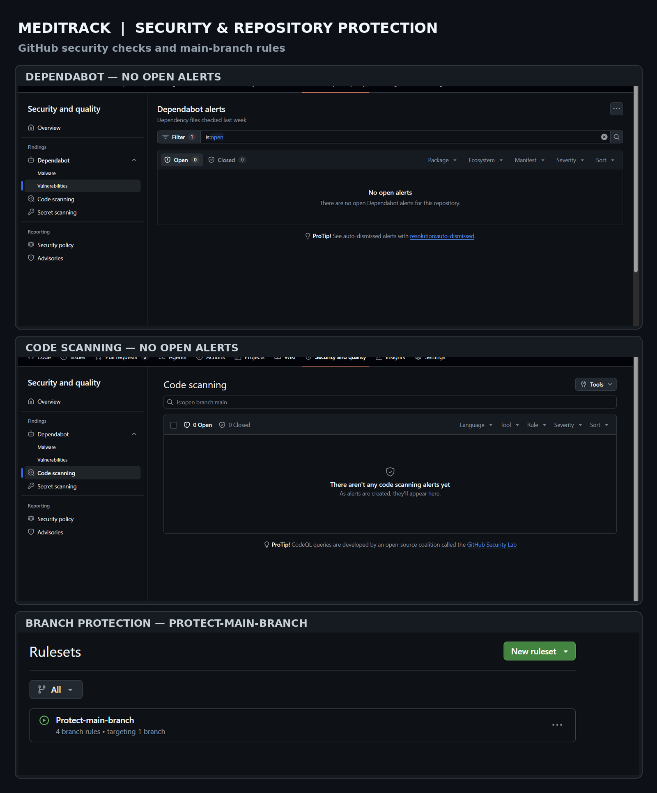

# MediTrack – Android DevSecOps

An Android medical records application built with integrated DevSecOps practices, automated CI/CD, and security controls.

MediTrack is designed to help users organize personal medical records, including medications and appointments. The project combines Android development with automated build and testing workflows, security analysis, dependency monitoring, and repository protection using GitHub

---

## 📱 Application Overview

MediTrack provides a simple and intuitive interface for managing personal medical records.


**Core Features**
- Add medication and appointment records.
- Store descriptions, dosage details, and dates.
- View and search saved records.
- Delete existing records.

---

## ⚙️ DevSecOps Pipeline

Automated CI/CD workflows built with GitHub Actions streamline the build, testing, and artifact generation process.

**CI Workflow**
- Automated triggers on pushes and pull requests to `main`.
- JDK 17 and Gradle environment setup.
- Automated unit testing.
- Android APK build.
- APK artifact upload.
- Build-status notifications delivered to mobile devices through ntfy.


---

## 🔐 Security & Code Quality

Security controls are integrated into the development workflow to support code analysis, dependency monitoring, and repository protection.

| Tool / Control | Purpose |
|---|---|
| GitHub CodeQL | Static code analysis for Java/Kotlin and GitHub Actions workflows |
| Dependabot | Automated dependency updates and vulnerability monitoring |
| Secret Scanning | Detection and alerts for exposed credentials and secrets |
| Branch Protection | Protecting the `main` branch |
| Required Status Checks | Requiring successful CI checks before merging pull requests |
| Repository Rules | Preventing force pushes and branch deletion |




---

## 🛠️ Technology Stack

- **Android Development:** Android SDK, Java/Kotlin, Gradle
- **CI/CD Automation:** GitHub Actions
- **Static Analysis:** CodeQL
- **Dependency Management:** Dependabot
- **Repository Security:** GitHub Rulesets, Branch Protection
- **Secret Detection:** GitHub Secret Scanning
- **Notifications:** ntfy
- **Version Control:** Git and GitHub

---

## 🚀 Build Locally

**Requirements:** JDK 17 and Android SDK.

```bash
git clone https://github.com/Reemaaldajani/MediTrack-Android-DevSecOps.git

cd MediTrack-Android-DevSecOps

chmod +x gradlew

./gradlew testDebugUnitTest

./gradlew assembleDebug
```

**APK Output:**

`app/build/outputs/apk/debug/`

---

## 👩‍💻 Project

MediTrack demonstrates the practical integration of Android development, CI/CD automation, and application security within a continuous development workflow.

**Focus:** Android Development · DevSecOps · CI/CD Automation · Application Security · Repository Protection
